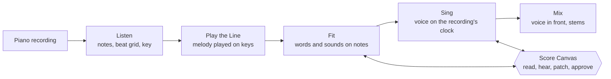

# ARRANGE

Agent skills that add a singing voice to a composer's own piano recording, one readable step at a time.

This repository accompanies the paper *ARRANGE: Agentic Skills for Layering Vocals* (Henry Tan). It contains the
skills and, for each experiment in the paper's evaluation, the code, the stored model outputs and a command that
recomputes its numbers.

[Project page](https://htansetiawan.github.io/arrange/) · [Listen to the worked example](audio/)

## The idea

Song generators turn a prompt into a finished track but show none of the decisions inside it, and they replace the
composer's own performance. ARRANGE keeps the recording and treats adding a voice as compilation. The composer writes
the program in plain English, in notes played on a keyboard over the recording, and in their own voice. An LLM agent
compiles it one skill at a time. Each skill writes an intermediate the composer can read in notation they already know,
an engraved score with the words under the notes and the sounds sung on each note, and stops at a checkpoint the agent
cannot pass for the composer. When something is wrong, the composer patches the intermediate, not the prompt.

Changes work the same way. A request in English ("bring the strings in two bars later") is compiled into *typed
edits*: short instructions from a fixed vocabulary, each naming one operation and its arguments
(`shift_entry(layer="strings", by_bars=2)`). Typed is meant as in a strongly typed language: a script checks each
edit's operation and arguments and rejects one that does not fit before it runs, so nothing an edit does not name can
change. A request too vague to compile becomes a question instead of a guess.



Open models do the audio work below each skill (piano transcription, singing synthesis, voice conversion, separation)
and can be swapped without changing the workflow or the canvas.

## Repository

| Path | Contents |
|---|---|
| `skills/` | The skills, in the Agent Skills format (a `SKILL.md`, scripts and references per folder) |
| `experiments/revisions/` | Section 5.1: typed edits against rewriting the plan, five LLMs, sessions |
| `experiments/corrections/` | Section 5.1: the composer's own corrections replayed as requests |
| `experiments/canvas-edits/` | Section 5.1: 62 curated edit requests on the score canvas; the skill installed as a Claude skill |
| `experiments/voices/` | Sections 5.3 and 5.4: what open voice models transfer; automatic measures against the ear |
| `experiments/keys/` | Section 5.5 and Figure 3: choosing the key for a copied voice |
| `audio/` | The worked verse of Section 5.2: the author's piano, and the same bars with his words sung over it |
| `docs/setup.md` | Installing the model backends and pointing the skills at them |
| `tests/` | Checks that the stored results still give the paper's numbers |

### The skills

| Step in the paper | Skill | Main scripts |
|---|---|---|
| Listen | `arrange-listen` | `transcribe.py` (piano transcription), `analyze.py` (beat grid from tapped beats, key, sections) |
| Play the Line | `arrange-lyrics` | `recorder.py`, `take.py` (removes the player's lead over their own taps), `merge_take.py` |
| Fit | `arrange-lyrics` | `lay.py`, `phonemes.py` (sounds per note), `canvas.py` (the Score Canvas), `show_fit.py`, `edit_fit.py` |
| Plan | `arrange-plan` | `revise.py` (typed edits), `validate.py`, `tracks.py` |
| Sing | `arrange-lyrics`, `arrange-render` | `sing.py`, `center.py` (key rules), backend `soulx.py` (records each take's seed) |
| Mix | `arrange-lyrics`, `arrange-render` | `mixcheck.py` (entry check), `mix.py`, `polish.py`, `export.py` |

`arrange-brainstorm` turns a composer's intent into an editable notebook that `arrange-plan` reads; the paper does not
evaluate it.

## Use the skills

The skills run inside an agent that supports Agent Skills, such as Claude Code. Copy or link the folders into a
project's `.claude/skills/` (or `~/.claude/skills/` for every project):

```
git clone https://github.com/htansetiawan/arrange
mkdir -p .claude/skills && cp -r arrange/skills/arrange-* .claude/skills/
```

Then ask the agent in plain language, for example "add a voice to my recording piano.wav with these words". The
scripts that read and write scores, fits and plans need only Python. Transcription, singing and voice conversion need
the model backends in [`docs/setup.md`](docs/setup.md).

## Reproduce the paper

The tables and numbers in Section 5 are recomputed from the stored results without calling a model. Data from two of
the five songs is not distributed, so the corrections, voice and key folders recompute on the remaining songs; each of
those READMEs lists the numbers that differ from the paper.

```
pip install -r requirements-test.txt
python -m pytest -q tests
```

Each experiment folder has a README with the command for each number, what was run, and what is withheld. To run an
experiment again you need the Claude Code CLI for the Claude models, or any OpenAI-compatible server (the paper used
vLLM) for the open models.

| Section | Command, run in the folder | Output |
|---|---|---|
| 5.1 Typed revisions | `python3 summarize.py results/summary.json -o results/SUMMARY.md` | `results/SUMMARY.md` |
| 5.1 Across models | `python3 table_models.py` | `results-models/TABLE.md` |
| 5.1 Over a session | `python3 table_sessions.py` | `sessions-results/TABLE.md` |
| 5.1 The composer's corrections | `python3 paper_numbers.py` | printed |
| 5.1 Curated edits | `python3 suite.py --items`, `python3 skill_arm.py --table` | `ITEMS.md`, `results-skill/TABLE.md` |
| 5.3, 5.4 Voices, automatic measures | `python3 paper_numbers.py` | printed |
| 5.5 Keys | `python3 paper_numbers.py` | printed |
| Figure 3 | `python3 make_fig3.py` | `figures/fig3.png`, `.svg` |

## Data, rights and consent

- The evaluation songs are copyrighted melodies. Their note-level fits are not distributed, so the suites cannot be
  rerun from this repository alone. Model answers that reproduce a whole fit are withheld; their scores are kept.
- The audio is short excerpts included for research commentary: in `audio/`, the author's own piano recording and
  voice (the worked example of Section 5.2); on the project page (`docs/audio/`), 26 seconds of Yuval Cohen's live
  piano performance of *All the Things You Are* with the author's copied voice over it.
- Other singers' voices were used for research only, at 16 bars or less, with each voice's consent status recorded, as
  the paper describes. None of that audio is in this repository.
- If you hold rights in any material here and want it removed, open an issue.

## License

Code: Apache License 2.0 ([`LICENSE`](LICENSE)). Documentation, stored results and data: CC BY 4.0. The audio excerpts
and the third-party works they contain are not covered by either licence.

## Citation

```bibtex
@misc{tan2026arrange,
  title        = {{ARRANGE}: Agentic Skills for Layering Vocals},
  author       = {Tan, Henry},
  year         = {2026},
  howpublished = {\url{https://github.com/htansetiawan/arrange}}
}
```

## Acknowledgements

ARRANGE builds on open models and tools: SoulX-Singer for singing synthesis, high-resolution piano transcription by Kong
et al., Seed-VC for voice conversion, and g2p_en with the CMU Pronouncing Dictionary for pronunciation.
